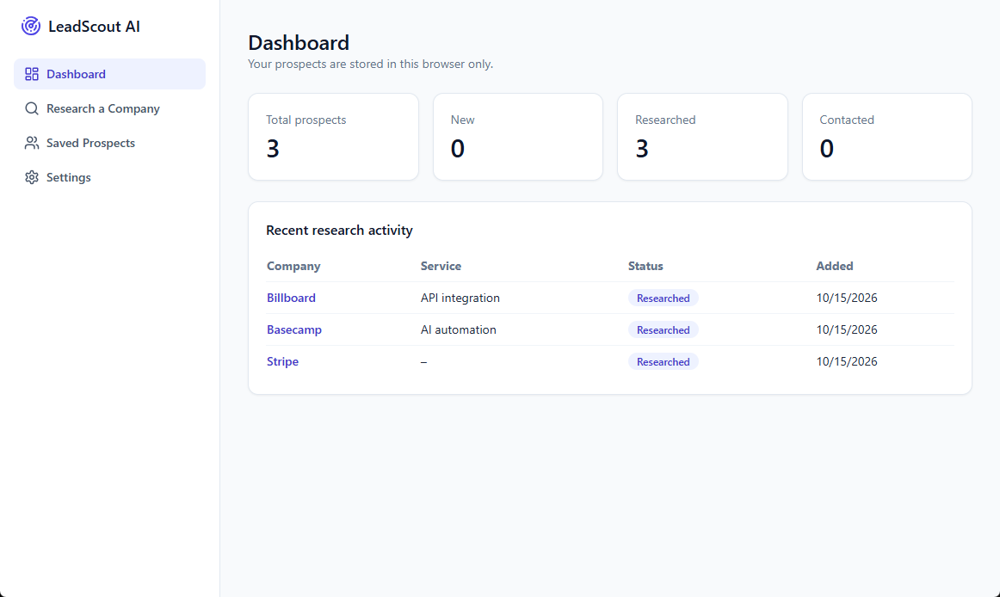
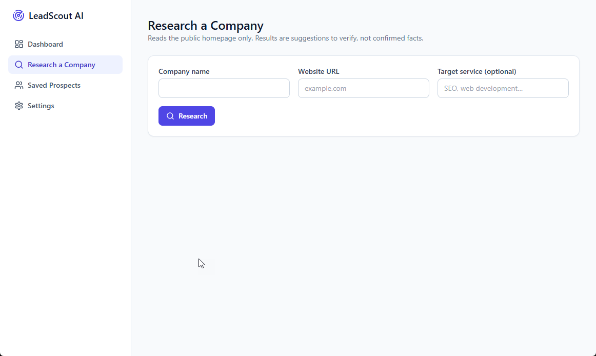
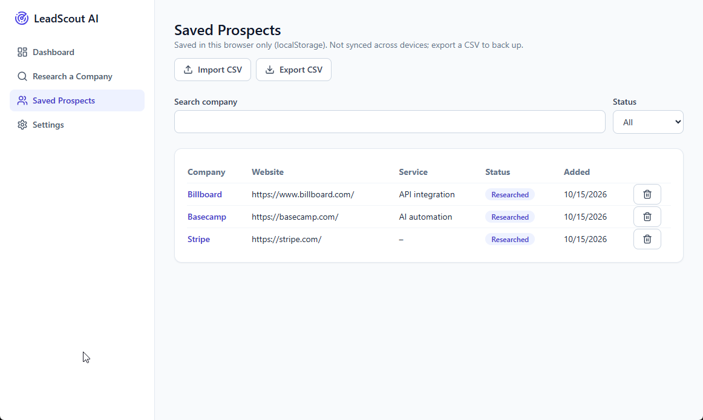

# LeadScout AI

AI-assisted lead research for freelancers, developers and small agencies. Enter a company and website; the Python backend fetches the public homepage, extracts structured info, builds a preliminary profile and drafts an outreach email. **Core features work without any AI key.** Gemini is an optional, user-triggered enhancement. No database, no Docker, no paid services required.

## Screenshots

### Dashboard


### Research a Company


### Saved Prospects


## Features
| Feature | Needs AI key? |
|---|---|
| Website research (title, meta description, headings, text) | No |
| Basic company profile with labelled suggestions and limitations | No |
| Template outreach draft, edit, copy | No |
| Prospects in localStorage: search, filter, delete, CSV import/export | No |
| Dashboard | No |
| AI summary, opportunities, personalised email, AI regeneration | Yes (`GEMINI_API_KEY`, server-side) |

AI runs only when you click an AI button, to conserve free-tier quota. Emails are never sent automatically.

## Tech stack
Next.js 14 (App Router), TypeScript, Tailwind CSS, React, Lucide; Python, FastAPI, Pydantic, HTTPX, BeautifulSoup4; optional Google Gemini (`google-genai`); `python-dotenv` for local development only; Vercel Hobby for hosting.

## Architecture
```
app/, components/, lib/   Next.js frontend (localStorage store, CSV, API client)
api/index.py              FastAPI app: the single Vercel Python function
backend/                  security (SSRF), scraper, analysis, outreach, ai, schemas
tests/                    pytest, fully mocked (no live sites, no real API calls)
vercel.json               routes /api/* to api/index.py
```
Endpoints: `GET /api/health`, `POST /api/research`, `POST /api/ai-analysis`, `POST /api/generate-outreach`.

Locally, `next.config.mjs` proxies `/api/*` to uvicorn on port 8000 (development only). Two processes run locally: the FastAPI backend (port 8000) and the Next.js frontend (port 3000).

## Prerequisites
- Node.js 18.18+ (20 LTS recommended)
- Python 3.10+ installed from python.org (tick **"Add python.exe to PATH"** in the installer)
- Git

## Local development (Windows PowerShell)
Run everything from the project root (the folder that contains `package.json` and `requirements.txt`).

**Terminal 1: backend**
```powershell
py -m venv .venv
.\.venv\Scripts\Activate.ps1
pip install -r requirements-dev.txt
uvicorn api.index:app --reload --port 8000
```

**Terminal 2: frontend**
```powershell
npm install
npm run dev
```
Open http://localhost:3000. Check the backend at http://localhost:8000/api/health.

## Environment variables
Copy `.env.example` to `.env` (or `.env.local`) **in the project root**. The example file lists both variables; fill in your own values:
```
GEMINI_API_KEY=your-key-here
GEMINI_MODEL=your-model-name
```
- No quotes or spaces around `=`.
- These are read by the **Python backend**, which loads the file on startup via `python-dotenv` (local development only). Restart uvicorn after any change.
- Never prefix them with `NEXT_PUBLIC_`, and never commit them. `.env` and `.env.local` are in `.gitignore`.
- On Vercel, set them in Project Settings, Environment Variables instead.

## Optional Gemini setup
1. Create an API key in Google AI Studio.
2. Put it in `.env` as `GEMINI_API_KEY`.
3. Optionally set `GEMINI_MODEL` to a model your key can use. If unset, the code defaults to `gemini-3.8-flash`; model availability changes over time, so check Google's current model list.
4. Restart uvicorn and open `/api/health`. `"ai_available": true` means the key was detected. **Settings** in the app shows the same status.

If the quota is exhausted or a call fails, the app shows an error and every non-AI feature keeps working.

## Tests and type-check
```powershell
python -m pytest -q
npm run typecheck
```

## Troubleshooting
| Problem | Fix |
|---|---|
| "Python was not found; run without arguments to install from the Microsoft Store" | Install Python from python.org with "Add to PATH", disable the Store aliases (Settings, Apps, Advanced app settings, App execution aliases), reopen the terminal. Use `py` instead of `python` meanwhile. |
| `Could not open requirements file` | You're in the wrong folder. `cd` into the project root first. |
| Script execution blocked when activating the venv | `Set-ExecutionPolicy -Scope CurrentUser RemoteSigned` |
| `ai_available` is `false` | The backend doesn't see the key. Check `.env` location, spelling and formatting, then restart uvicorn. |
| AI buttons fail with a key set | Check the model name in `GEMINI_MODEL`, your quota, and the uvicorn terminal output. |
| "Request failed. Is the backend running?" | Start uvicorn on port 8000. |

## Publish to GitHub
Run from the project root so the repository root matches the project folder:
```powershell
git init
git add .
git commit -m "Initial commit: LeadScout AI"
git branch -M main
git remote add origin https://github.com/<you>/leadscout-ai.git
git push -u origin main
```
Before pushing, confirm with `git status` that `.env`, `.env.local` and `.venv` are not listed.

## Deploy to Vercel
1. Import the GitHub repo at vercel.com/new (framework preset: Next.js).
2. Add `GEMINI_API_KEY` (and optionally `GEMINI_MODEL`) under Environment Variables.
3. Deploy, then open `/api/health` on the deployed URL to confirm the Python function responds.

The Vercel deployment has not been tested by the author of this README. If something differs, check the current Vercel Python runtime docs (entry point `api/index.py`, an ASGI `app` object, root `requirements.txt`).

## Known free-tier limitations
- Serverless time limits and cold starts; slow sites may time out.
- Rate limiting is in-memory per instance, so it is best-effort only.
- Gemini free-tier quotas and model availability can change.
- JavaScript-rendered sites yield little content because no JavaScript is executed.
- Prospects live in one browser's localStorage; clearing site data deletes them and nothing syncs across devices.

## Security considerations
- **SSRF:** http/https only, restricted ports, no credentials in URLs, every resolved IP must be public (blocks localhost, private, link-local including cloud metadata, and IPv6 equivalents). Redirects are followed manually and re-validated at each hop.
- **Known limitation:** DNS is resolved at validation and again at connection, so a DNS-rebinding race is reduced but not fully eliminated. A strict fix needs IP-pinned connections or an egress proxy, which isn't practical in this architecture.
- Response size (1 MB), timeouts and processed text are capped; no JavaScript is executed; authentication, CAPTCHAs and paywalls are not bypassed.
- Scraped text is treated as untrusted data in AI prompts (delimited, with instructions to ignore embedded commands). This lowers but cannot eliminate prompt-injection risk, so always review AI output before using it.
- API keys stay server-side; provider error text is never returned to the client.
- CSV export neutralises formula-leading characters (`= + - @`). Import validates header, size (1 MB), row count (500), field lengths, statuses and URL schemes.
- No personal data is collected beyond what you type.

## Example usage
1. **Research a Company:** enter "Acme", `acme.com`, target service "SEO", then Research.
2. Review the profile. Optionally click **Run AI analysis** (requires a key).
3. Edit the draft, **Copy** it, then **Save prospect**.
4. In **Saved Prospects**, update status, search, filter, and export or import CSV backups.
